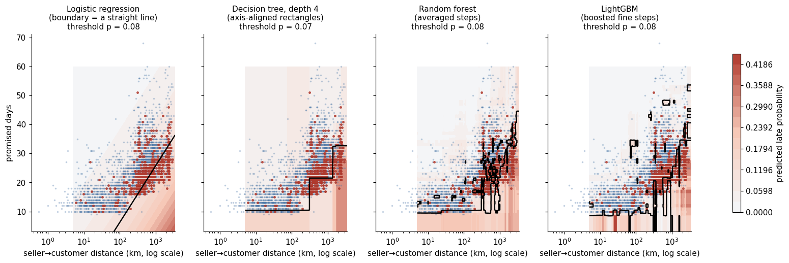
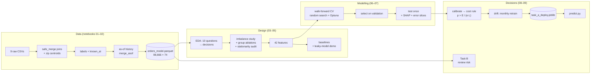
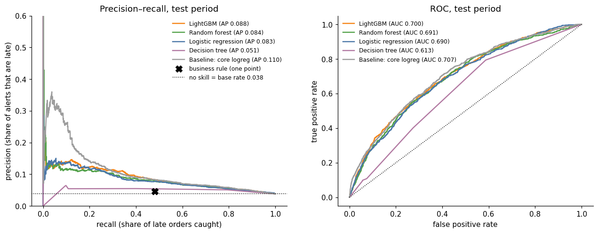

<div align="center">

# 📦 Olist Delivery Promise Risk

### Will this order be late? Predicting it at checkout, before it happens.

**An end-to-end classical-ML project on 99,441 real orders from a Brazilian marketplace: leakage-safe features, time-honest validation, four tuned model families, explainability, and a cost-based decision layer.**

[](#-getting-started)
[](requirements.txt)
[](requirements.txt)
[](requirements.txt)
[](notebooks/07_evaluation_and_explainability.ipynb)
[](#-testing)
[](#%EF%B8%8F-project-stages)
[](https://www.kaggle.com/datasets/olistbr/brazilian-ecommerce)

[Results](#-results-at-a-glance) •
[The problem](#-the-problem) •
[Pipeline](#%EF%B8%8F-pipeline) •
[Key findings](#-key-findings) •
[Leakage defence](#%EF%B8%8F-leakage-defence) •
[Structure](#-repository-structure) •
[Getting started](#-getting-started) •
[📘 Plain-language guide](GUIDE.md)

</div>

---

> **New here?** Read **[GUIDE.md](GUIDE.md)** for a plain-language walkthrough: what was done, why, what was found, the key ideas explained simply, and likely viva questions. This README is the developer view.

## 🏁 Results at a glance

| | |
|---|---|
| **Data** | 9 relational tables · 99,441 orders · 89,795 in the modelling population · 6.84% late |
| **Features** | 57 registered checkout-time features → **42** after ablations and a stationarity audit |
| **Models** | Logistic regression (elastic net) · Decision tree · Random forest · LightGBM, each tuned with walk-forward CV |
| **Selected model** | Regularised logistic regression (best validation PR-AUC **0.221** against a 0.118 base rate) |
| **Test period** (May–Jul 2018, 3.8% late) | PR-AUC **0.083** (2.2× base rate), ROC-AUC 0.69, catches 37% of late orders while flagging 17% |
| **Honest surprise** | A 5-feature baseline scores **0.110** on test and beats every tuned model: parsimony wins under regime change |
| **Decision layer** | Per-order cost rule; under the default costs expediting doesn't pay in a 3.8%-late month (−293 BRL / 1,000 orders vs 0 for doing nothing, against +470 in the 11.8%-late validation period); monthly retraining cuts losses |
| **Task B** (bad reviews) | PR-AUC **0.196** (2.2× base rate); a 20-calls-a-day list reaches 2.2× more unhappy customers than random |
| **Deliverables** | 9 executed notebooks · 9 stage reports · 36 figures · 31 result tables · `predict.py` · `run_all.py` · 35 tests |

<p align="center">
  <br>
  <sub><b>How each model family draws its boundary</b> (2 features only): logistic regression is a straight line (a hyperplane), the tree draws rectangles, the forest and LightGBM draw stepped, bendy frontiers.</sub>
</p>

---

## 🎯 The problem

When a customer checks out, the marketplace promises a delivery date. Late orders get a 1★ or 2★ review **65%** of the time, compared with **9.5%** for on-time ones.

| | **Task A: late-delivery risk** *(primary)* | **Task B: dissatisfaction risk** *(secondary)* |
|---|---|---|
| Question | Will this order arrive after the promised date? | Will this customer leave 1–2★? |
| Prediction moment | At checkout | At delivery, before the review request |
| Action | Expedite, give an honest ETA, or offer a voucher | Proactive support call (k per day) |
| Primary metric | PR-AUC + cost saved per 1,000 orders | PR-AUC + precision of the daily call list |

---

## 🏗️ Pipeline



| Split | Purchases | Orders | Late rate | Used for |
|---|---|---:|---:|---|
| train | 2017-01 → 2018-02 | 57,050 (50,356 after the maturity purge) | 6.63% | fitting; walk-forward CV on Nov–Feb |
| validation | 2018-03 → 2018-04 | 13,801 | 11.84% | model selection, thresholds, calibration |
| test | 2018-05 → 2018-07 | 18,944 | 3.81% | final evaluation |

---

## 🔍 Key findings

<details open>
<summary><b>1. Accuracy is meaningless here, and SMOTE doesn't help</b></summary>

"Always on time" is 88% accurate on validation and catches nothing. Across five imbalance strategies (none, class weights, undersampling, SMOTE-NC, threshold moving), **none ranks better than a plain fit**, and every resampling method damages the probabilities (logistic-regression Brier 0.092 → up to 0.42). → [Stage 5–7 report](reports/04_preprocessing_imbalance_features.md)
</details>

<details>
<summary><b>2. Some features are secretly clocks</b></summary>

- **`purchase_month`** raises within-month CV but *collapses* pooled cross-month ranking (0.155 → 0.123): it memorises one-off months (February: 3% late in 2017, 14% in 2018).
- **`market_resolved_30d`** has ρ = 0.95 with the purchase date, and adversarial validation separates training from validation rows with AUC 1.0.

Five clock features were removed on principle: features should describe the order, not the calendar.
</details>

<details>
<summary><b>3. Leakage would have faked an 87% improvement</b></summary>

Adding a full-data seller late rate and a post-checkout carrier-handoff time lifts validation PR-AUC from 0.188 to 0.352. All of that gain is fake. → [Stage 8 report](reports/05_baselines.md)
</details>

<details>
<summary><b>4. Validation and test disagree, and simplicity wins under drift</b></summary>

Tuned models win validation (0.22 vs 0.14 for the core baseline) but lose test (0.08 vs 0.11). A 4-feature model (distance, promise, seller rate, freight ratio) matches the baseline, so the edge is **parsimony**, not the month. The test set was looked at twice (a disclosed fix in between); both sets of numbers are reported. → [Stage 11 report](reports/07_evaluation.md)
</details>

<details>
<summary><b>5. Money: when is expediting worth it?</b></summary>

Under the default costs the break-even risk is about 46%. The model policy saves +470 BRL per 1,000 orders in a high-lateness period but loses 293 in a low one, while expediting everything loses 12,497. The break-even map shows it pays when expediting works at least 75% of the time and a late order is costly. Monthly retraining improves ranking (mean PR-AUC 0.081 → 0.096) and cuts losses. → [Stage 12 report](reports/08_decision_analysis.md)
</details>

<details>
<summary><b>6. For late orders, the review request arrives before the parcel</b></summary>

For 75.8% of late orders the review request comes before delivery, and 75.7% of those customers leave 1–2★. Post-delivery outreach is too late for them, so **checkout-time prediction (Task A) is the only lever against lateness**. Task B's strongest signal is multi-item orders. → [Task B report](reports/09_task_b.md)
</details>

<p align="center">
  <br>
  <sub><b>Test-period curves.</b> All tuned models sit above the base rate. The 5-feature baseline (grey) wins in its top 5–10% of orders.</sub>
</p>

---

## 🛡️ Leakage defence

- **`known_at = min(delivered_ts, promised_date + 1 day)`:** when the marketplace actually learns an outcome. History features count only events with `known_at < purchase time`, computed in O(n log n) with `merge_asof` on cumulative sums.
- **Registry + forbidden list** ([`features.py`](src/olist/features.py)): every input has a source and a *known-when*; a test asserts no forbidden column is ever an input. `DROPPED_AFTER_ABLATION` records every removed feature and the evidence.
- **Future-perturbation test:** randomise every outcome known after 2018-01-01, and earlier features must stay bit-identical. Brute-force O(n²) checks confirm `merge_asof`.
- **Maturity purge:** training rows are kept only if `promised_date + 1 ≤ cutoff`, a rule known at checkout. The obvious `known_at < cutoff` rule was rejected because it selects on the label.
- **`safe_merge`:** refuses one-to-many joins and asserts row counts.
- **Walk-forward folds** apply the same maturity rule at every fold start (tested).

---

## 📁 Repository structure

```text
Machine-Learning-Assignment/
├── README.md                   ← developer overview (this file)
├── GUIDE.md                    ← plain-language walkthrough + viva Q&A
├── SOURCES.md                  ← data licence, libraries, AI-use log
├── Olist Delivery Promise Risk ML Topic Proposal.md
├── predict.py                  ← score unseen orders with the deployed model
├── run_all.py                  ← rebuild everything from raw CSVs in one command
├── requirements.txt · pytest.ini · conftest.py · .gitignore
│
├── src/olist/                  ── reusable, tested package ──
│   ├── config.py               paths, formats, cutoffs, split dates, constants
│   ├── io.py                   typed loaders, strict date parsing, data checksums
│   ├── audit.py                profiling, keys, FK coverage, timestamp anomalies
│   ├── joins.py                safe_merge (cardinality-enforced joins)
│   ├── geo.py                  zip centroids, hierarchical fallback, haversine
│   ├── calendar.py             Brazilian holidays, business days, Black Friday
│   ├── history.py              as-of (point-in-time) features via merge_asof
│   ├── dataset.py              labels, known_at, aggregation, dataset build
│   ├── features.py             feature registry, FORBIDDEN, ablation drops, leakage audit
│   ├── split.py                chronological split + maturity purge
│   ├── modeling.py             pipelines, winsorizer, walk-forward folds, SMOTE-NC, model zoo, search spaces
│   ├── baselines.py            majority, business rule, core logistic regression
│   ├── evaluate.py             metrics, per-period scores, bootstrap CIs, top-k
│   ├── decision.py             cost model, policies, profit curves, sensitivity
│   └── scoring.py              deployed-model scoring + per-order risk factors
│
├── notebooks/                  ── executed, each = question → finding → decision ──
│   ├── 01_data_audit.ipynb                      stages 1–2
│   ├── 02_data_preparation.ipynb                stage 3
│   ├── 03_eda.ipynb                             stage 4
│   ├── 04_preprocessing_and_imbalance.ipynb     stages 5–7
│   ├── 05_baselines_and_decision_boundaries.ipynb  stage 8 (+ hyperplanes)
│   ├── 06_models_and_tuning.ipynb               stages 9–10
│   ├── 07_evaluation_and_explainability.ipynb   stage 11
│   ├── 08_decision_analysis.ipynb               stage 12
│   └── 09_task_b_review_risk.ipynb              Task B
│
├── reports/
│   ├── 01_table_selection.md … 09_task_b.md     one written report per stage
│   ├── figures/                                 every figure, prefixed by notebook
│   ├── results/                                 every result table (CSV/JSON)
│   ├── predictions.csv                          example predict.py output
│   └── data_checksums.json                      SHA-256 of the source CSVs
│
├── tests/                      ── 35 tests ──
│   ├── test_io.py · test_joins.py · test_geo.py · test_history.py
│   ├── test_dataset.py · test_split.py
│   ├── test_modeling.py        train-only fitting, winsorizer, folds never see unknown labels
│   ├── test_decision.py        break-even maths, policies, metrics, baselines
│   └── test_scoring.py         deployed model scores unseen orders consistently
│
├── Dataset/   (Git LFS)        the 9 raw CSVs
├── data/      (Git LFS)        zip centroids + processed parquet
└── models/    (Git LFS)        trained models (rebuilt by notebooks 06, 08, 09)
```

---

## 🚀 Getting started

The raw CSVs, processed data and trained models are stored with [Git LFS](https://git-lfs.com), so install it before cloning:

```bash
git lfs install
```

```bash
git clone https://github.com/Priyansh9506/Machine-Learning-Assignment.git
```

```bash
pip install -r requirements.txt
```

If you cloned without LFS, the files in `Dataset/`, `data/` and `models/` are small pointer files; run `git lfs pull` to fetch the real ones. Python 3.11+ is required.

> [!IMPORTANT]
> The copy used here stores `orders`/`order_items` timestamps as day-first `DD-MM-YYYY HH:MM`. The Kaggle release uses `YYYY-MM-DD HH:MM:SS`, and the loader deliberately raises a `ValueError` on a mismatch. With the Kaggle copy, set `ORDER_TS_FORMAT = "%Y-%m-%d %H:%M:%S"` in [`config.py`](src/olist/config.py). `run_all.py` warns if the files differ from the reference checksums.

**Rebuild everything** (notebooks 01→09, figures, tables, models, then the tests; about 30–45 minutes, mostly tuning):

```bash
python run_all.py
```

**Score orders still in transit** with the deployed model:

```bash
python predict.py
```

Example output (`reports/predictions.csv`): one row per order with `p_late`, its own `break_even_p`, the action and the top risk factors.

```text
order_id                          route     p_late  break_even_p  action    top_risk_factors
b6906ad8ffc10ced26f9f5850aabea27  SP -> RJ  0.1143  0.3254        standard  promised_business_days=6; promised_days=9; customer_state_RJ=1
81a37715c2240c1701ab6b81bb52e737  SP -> BA  0.0989  0.2995        standard  dest_state_late_rate_90d=0.249; distance_km_min=1.48e+03; …
```

**Use the package directly:**

```python
import sys; sys.path.insert(0, "src")
from olist.modeling import load_task_a, task_a_sets, make_model
from olist.features import model_features

S = task_a_sets(load_task_a())                 # train (matured) / train_period / val / test
F = model_features()                           # the 42 final features
m = make_model("logreg", F, C=0.003, l1_ratio=0.31).fit(S["train"][F], S["train"].late_day)
```

---

## 🧪 Testing

```bash
python -m pytest
```

35 tests in about 45 s (30 of them run in about 4 s with `-m "not data"`). They cover strict date parsing, cardinality-checked joins, geo fallbacks, **as-of history** (strictness, ties, brute force, future perturbation), labels, splits, preprocessing fitted on training rows only, walk-forward folds that never train on unknown labels, the break-even maths, and the deployed scorer.

---

## 🗺️ Project stages

| Stage | Notebook | Report | Status |
|---|---|---|:-:|
| 1–2 Data audit and table selection | 01 | [01_table_selection](reports/01_table_selection.md) | ✅ |
| 3 Integration, labels, as-of features, split | 02 | [02_data_preparation](reports/02_data_preparation.md) | ✅ |
| 4 EDA | 03 | [03_eda](reports/03_eda.md) | ✅ |
| 5–7 Preprocessing, imbalance, feature selection | 04 | [04_preprocessing_imbalance_features](reports/04_preprocessing_imbalance_features.md) | ✅ |
| 8 Baselines, leakage demo, decision boundaries | 05 | [05_baselines](reports/05_baselines.md) | ✅ |
| 9–10 Models and tuning | 06 | [06_models_tuning](reports/06_models_tuning.md) | ✅ |
| 11 Evaluation and explainability | 07 | [07_evaluation](reports/07_evaluation.md) | ✅ |
| 12 Decisions, drift, deployment | 08 | [08_decision_analysis](reports/08_decision_analysis.md) | ✅ |
| Task B Bad-review risk | 09 | [09_task_b](reports/09_task_b.md) | ✅ |

---

## ⚠️ Limitations

One marketplace (Brazil, 2016–2018). The cost parameters are assumptions, tested by sensitivity analysis. The data is observational, so expediting's effect is assumed, not measured. The drift is strong and validation looks unlike test. The test set was looked at twice (disclosed). The licence is non-commercial. Details: [GUIDE.md §8](GUIDE.md#8-limitations-said-honestly).

## 📚 Data and attribution

**Brazilian E-Commerce Public Dataset by Olist** ([Kaggle](https://www.kaggle.com/datasets/olistbr/brazilian-ecommerce)), CC BY-NC-SA 4.0. Libraries, references and the AI-use log are in [SOURCES.md](SOURCES.md).

<div align="center">

**Priyansh Patel** · B.Tech Semester 5 · Machine Learning Innovative Assignment

</div>
